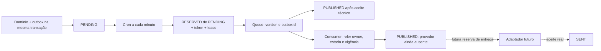

# TASK-BE-018 — Cron e Cloudflare Queues

Base: main `afccbe3` (BE-017 incorporada no PR #19; BE-016 no PR #18).
Recorte Code First de F5-06/F5-07 e estrutura de F5-08. Sem provedor,
credenciais, migration nova, provisionamento remoto ou deploy.

## Reserva e recuperação

Wrangler agenda `* * * * *` em UTC. Não há precisão garantida de segundo nem
processo Node persistente. O dispatcher usa o instante atual da execução, não
presume que scheduledTime represente o início real. Processa até 20 candidatos
por invocação (NOTIFICATION_BATCH_SIZE, inteiro 1–100), ordenados por scheduledAt
e UUID, com scheduledAt <= agora. Pode haver atraso sob backlog; não expande
recorrências nem renova janelas de planejamento neste ticket.

A consulta é descoberta **consultiva**, não reserva. Seleciona PENDING e RESERVED
com reservedFrom=PENDING e leaseUntil <= agora, somente de usuários ativos.
Cada candidato entra na transação já existente da BE-016: lock PostgreSQL
`users FOR UPDATE` por proprietário, leitura da fonte/regra/preferências,
reavaliação de estado/horário/vigência e UPDATE condicional por
id+ownerId+status+leaseToken observado. A reserva e o log RESERVED são atômicos.
A serialização por usuário mais CAS impede duas reservas simultâneas; não é um
findMany seguido de update incondicional. Preserva ordem usuário → fonte → outbox,
compatível com os hooks BE-017; não usa SKIP LOCKED em outbox antes de users.
A abordagem é conservadora, pode disputar o lock com CRUDs e não promete
throughput de um dispatcher com particionamento. Validar custo/concorrência no Neon.

Cada reserva ganha UUID novo, lease de 60s (NOTIFICATION_LEASE_SECONDS, 1–300)
e incrementa attemptCount. Reserva de publicação expirada pode ser substituída
atomicamente por outra RESERVED/PENDING com novo token; um worker antigo não
pode confirmar com token anterior. Histórico registra uma nova reserva por
recuperação; attemptCount conta operações técnicas, nunca e-mails enviados.
PENDING/RESERVED obsoletas viram CANCELLED, com log STALE. Canceladas/terminais,
PUBLISHED e reservas de entrega (reservedFrom=PUBLISHED) não são republicadas.

## Producer e falhas anteriores ao envio

`NOTIFICATION_QUEUE.send({version:1,outboxId}, {contentType:'json'})` envia apenas
a identidade persistente; não inclui owner, token, endereço ou conteúdo de e-mail.
Após resolução do send, `published` revalida lease/vigência e grava PUBLISHED e
log QUEUED. PUBLISHED significa aceite da fila, nunca aceite do provedor.

| Etapa / falha | Comportamento |
|---|---|
| Descoberta/banco | Log DISCOVERY_FAILED; Cron falha com erro genérico; próxima execução consulta novamente |
| Reserva/banco | Log RESERVATION_FAILED; erro de banco interrompe execução; conflitos/conta indisponível são ignorados; transação reverte reserva+log |
| Publicação | Log PUBLICATION_FAILED; mantém lease, continua outros candidatos; próximo Cron recupera só após expirar |
| Aceite da fila, falha na confirmação | Log CONFIRMATION_FAILED; lease permite recuperar publicação; duplicatas são possíveis |
| Mensagem entregue antes da confirmação | Retry técnico de 60s para RESERVED/PENDING; não inicia entrega |
| Leitura/preflight do consumer | Retry técnico de 60s, limitado pela configuração de fila; sem chamada a provedor |
| Provedor (futuro) | Não implementado; falha ou resultado incerto de envio não autoriza retry automático |

Tentativas de publicação são limitadas por lote/lease, mas não por total de
execuções Cron. Falhas persistentes exigem intervenção operacional e eventual
suspensão do Cron; não alteram a intenção para SENT/FAILED fictícios. Os logs
estruturados usam apenas categorias fixas e UUID da outbox lido/validado, sem
mensagem/stack/cause do driver, corpo recebido ou credenciais. Falhas de send e
confirmação têm categorias diferentes; a auditoria persistente continua usando
os enums existentes para transições efetivas. Não há transação distribuída entre
PostgreSQL e Queues nem garantia de exactly-once.

## Consumer sem provedor

Payload Zod estrito: version=1 e outboxId UUID. Mensagem inválida é ack mesmo
sem banco. O consumer deriva ownerId da outbox persistida, nunca do payload;
o repository valida conta ativa, propriedade da regra/fonte e preferências atuais.
Preflight cancela intenções vivas obsoletas. Ausente/cancelada/terminal ou estado
inelegível recebe ack sem avanço. RESERVED/PENDING aguarda confirmação com retry;
PUBLISHED válida registra PROVIDER_NOT_CONFIGURED e recebe ack, mantendo **todos
os campos inalterados**. Duplicatas repetem apenas a validação, sem novo efeito
persistido. Sem reserva de entrega, send fictício, SENT ou aceite falso.

O ponto futuro de integração é após preflight em `NotificationProcessor.consume`:
será necessário adquirir reserva de entrega, revalidar imediatamente antes da
chamada, invocar adaptador real e persistir aceite/falha antes do ack. O método
`accepted` existente só pode ser usado com aceite real observado do provedor.
Reservas de entrega expiradas nunca são recuperadas automaticamente nesta task.
Não basta adicionar uma chamada de e-mail ao ponto atual: leases, idempotência,
resultado incerto e ausência de retry de envio precisam continuar garantidos.

`max_retries=3`, `retry_delay=60`, lote consumidor 10/timeout 5s; DLQ
`mai-notifications-dlq`. Retentativas são apenas de infraestrutura anterior a
qualquer envio. Não há retryAll indiscriminado; em falha de inicialização somente
mensagens válidas são marcadas para retry. Após esgotamento, a DLQ retém o caso
para investigação; PUBLISHED não é automaticamente republicada pelo Cron.
Ack sem provedor consome a mensagem e deixa intenção aguardando funcionalidade
futura: ativar um adaptador depois **não** reenvia retroativamente esses registros.
Reprocessamento exige tarefa e procedimento manual próprios.

## Local e produção

`npm ci`, geração do Prisma conforme README/PRISMA-NEON-LOCAL, `npm run dev`.
Wrangler emula a Queue localmente; filas são bindings, não variáveis URL.
Health/testes isolados funcionam sem banco. Para testar Cron manualmente com
banco de desenvolvimento já autorizado, use
`curl "http://127.0.0.1:8787/cdn-cgi/local/scheduled?format=json"`.
O endpoint de teste pertence ao Wrangler local, conforme documentação atual.
Não há rota administrativa de aplicação adicionada. Sem DATABASE_URL, agendado
falha com categoria sanitizada; isso não valida persistência.

Produção exige criação **manual e posterior** de mai-notifications e
mai-notifications-dlq, vinculação ao Worker/ambiente correto e DATABASE_URL via
binding seguro já usado pela aplicação. Revisar nomes isolados por ambiente,
retenção/cotas/custos e monitoração da DLQ antes de habilitar Cron. A configuração
Wrangler está preparada, nenhum recurso foi criado. Não executar deploy nem
migrations como parte do setup. Não são necessárias credenciais Gmail nesta task.

Gmail depende de PoC Workers/API HTTP ou SMTP (ADR-005/F0-11), autenticação segura,
adaptador, destinatários autorizados, conteúdo/template, persistência de aceite,
política de resultado incerto e validação E2E em tarefa futura. Resumo de conteúdo,
renovação de janela, UI de histórico/intervenção e observabilidade remota continuam
fora deste recorte.

## Evidências e limites

567 testes locais em 32 arquivos passaram, incluindo 29 novos de processamento e
handlers; lint, typecheck e build dry-run passaram. Os testes cobrem seleção/lote,
concorrência simulada, lease/recuperação/token antigo, falhas/duplicação de publicação,
mensagem inválida/obsoleta/cancelada, banco, ownership, idempotência, logs sanitizados
e consumer sem provedor/SENT. A suíte existente continua incluindo HTTP em workerd. Smoke adicional: /health
retornou 200 e /auth/me sem sessão retornou 401. O endpoint local de teste Cron
retornou 500/outcome exception por ausência de banco, com erro sanitizado; apenas
a presença do handler e o caminho de falha foram verificados, sem sucesso da outbox.
Mocks/serialização em memória existem somente nos testes e não provam locks,
rollback, concorrência, índices ou execução SQL real. Neon, migrations anteriores,
Cron/Queues/DLQ remotos e E2E com provedor permanecem **não executados**.

Documentação oficial consultada em 2026-11-15 pelo repositório Cloudflare
(website direto bloqueado pelo proxy):

- [Cron Triggers](https://github.com/cloudflare/cloudflare-docs/blob/production/src/content/docs/workers/configuration/cron-triggers.mdx)
- [scheduled handler](https://github.com/cloudflare/cloudflare-docs/blob/production/src/content/docs/workers/runtime-apis/handlers/scheduled.mdx)
- [JavaScript Queues API](https://github.com/cloudflare/cloudflare-docs/blob/production/src/content/docs/queues/configuration/javascript-apis.mdx)
- [batching e retries](https://github.com/cloudflare/cloudflare-docs/blob/production/src/content/docs/queues/configuration/batching-retries.mdx)

Bindings e estrutura também conferidos com workers-types e schema do Wrangler
fixados no lockfile. Build/HTTP local não certificam operação Cron→Queue→Neon.
