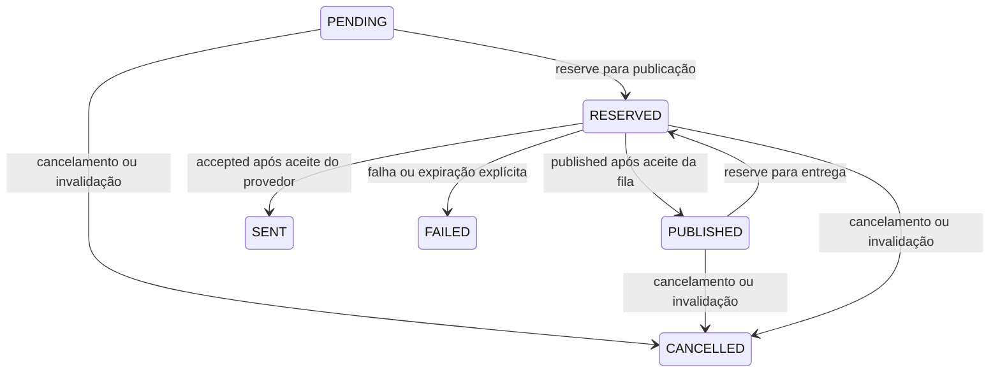

# Notificações e outbox — TASK-BE-016

Fundação persistente interna para F5-01/F5-02. Implementação preparada para revisão;
nenhum envio, Cron, Queue, consumer, conteúdo de resumo, API pública ou frontend.
Os marcadores O-09/O-10 do backlog não tinham política detalhada implementada;
este recorte documenta as escolhas operacionais para revisão, preservando a regra
já fechada de **não retentar automaticamente envio**. Gmail/transporte continuam
pendentes de PoC/decisão, não são escolhidos ou configurados por este módulo.

## Modelos e integridade

- **ReminderRule / reminder_rules:** uma configuração por owner/sourceType/sourceId,
  com antecedência inteira de 0 a 43.200 minutos, enabled e versão. Reconfiguração
  efetiva incrementa versão, preserva ID e cancela intenções vivas anteriores na
  mesma transação, com logs. Repetir a mesma configuração não cria versão/log extra.
  Configurar uma entidade própria arquivada/concluída é permitido, mas isso não a
  torna elegível para criar/processar lembrete. enabled omitido em configure é true;
  configure é uma configuração completa, não PATCH de campos ausentes.
- **NotificationOutbox / notification_outbox:** intenção individual, sem corpo de
  e-mail ou destinatário duplicado. Guarda tipo, referência/validade da origem e da
  regra, identidade original da ocorrência, data civil de resumo, fuso, scheduledAt
  UTC, status, idempotência, lease técnico, timestamps de resultado e categoria de
  falha. attemptCount conta reservas técnicas (publicação e entrega), não e-mails
  enviados. Um lease é um token técnico UUID, não credencial do provedor.
- **NotificationDeliveryLog / notification_delivery_log:** trilha somente aditiva de
  mudanças efetivas, com status, resultado, attemptedAt, categoria enumerada de erro
  e ID opaco do provedor quando aceito. Não guarda tokens de acesso, credenciais,
  corpo/resposta do provedor ou erros livres potencialmente sensíveis. Chamadores
  internos devem fornecer somente o ID de mensagem, nunca headers/respostas brutas.

FKs para usuário e compostas (reminderRuleId,ownerId) e (outboxId,ownerId) impedem
associação de outbox/log a regras/intenções de outro proprietário. A referência
polimórfica à tarefa/evento/publicação é validada e bloqueada no repository por
id+ownerId; **não há FK polimórfica PostgreSQL aos três modelos de domínio**.
Escritas diretas fora desse repository não recebem essa validação de origem.
Sem exclusão de histórico em cascata; remoção/retenção exige política futura.

Unique(ownerId,idempotencyKey) identifica uma intenção. Para resumo há também
unique(ownerId,type,digestDate): no máximo um DAILY_DIGEST por usuário/dia, mesmo
após falha/cancelamento ou mudança de fuso. PostgreSQL permite digestDate null em
lembretes; o CHECK distingue lembretes de resumos. Versões/chaves/recorrências e
leases têm CHECKs SQL; preservar as restrições manuais em migrations futuras.
Índices por status/scheduledAt, status/leaseUntil, proprietário/data e histórico.

## Horários, fusos e recorrência (O-09)

Todos os scheduledAt são instantes TIMESTAMPTZ(3) UTC. A antecedência é duração em
minutos subtraída do início efetivo, não conversão arbitrária de data civil:

| Origem | Âncora do lembrete |
|---|---|
| Tarefa pontual com dueDate civil | 09:00 local na preferência IANA atual do proprietário; sem dueDate não há lembrete |
| Tarefa recorrente | 09:00 na data original da ocorrência e fuso da regra atual ACTIVE; conclusão do mestre não conclui automaticamente a ocorrência |
| Evento pontual | startAt armazenado; não alterar o instante ao apresentar outro fuso |
| Evento recorrente | Relógio da âncora/fuso da versão atual ACTIVE, usando schedule/resolveLocal existentes; exceção movida usa startAt efetivo e mantém identidade da data original |
| Publicação | scheduledAt, nunca publishedAt; sem data não há lembrete |
| Resumo diário | Data civil informada + dailyDigestTime na preferência IANA atual da BE-015 |

09:00 é a convenção inicial explícita para tarefas sem hora, não alteração de seu
prazo civil nem campo novo na tarefa. O MVP não oferece hora específica por regra.
Para relógio local inexistente em DST, não deslocar automaticamente: criação é
recusada. Em relógio duplicado, resolveLocal escolhe o primeiro instante, como nos
eventos. Não somar 24h para calcular dias locais. Mudar preferência não reescreve
instantes/datas/fusos históricos de atividades; uma intenção antiga pode ser
invalidada pela nova preferência e um futuro planejamento criará outra válida.

Configuração não materializa série. Cada createReminder aceita um reminderRuleId e
occurrenceDate opcional: obrigatória se a origem tem recorrência e inválida para
origem pontual/publicação. O repository verifica a regra atual, estado ACTIVE,
data existente no calendário limitado do motor e conclusão/cancelamento individual.
PAUSED/ENDED, arquivo, tarefa pontual COMPLETED/CANCELLED, evento cancelado e
publicação CANCELLED/PUBLISHED impedem lembrete. Não existe regra persistente para
cada ocorrência futura. IDs/versões anteriores não são alvos de novas intenções.

Criações novas têm janela **de envio** [agora,agora+30×24h], sem backfill. O futuro
planejador deve selecionar atividades/ocorrências cujo envio cai nessa janela;
com antecedência máxima de 30 dias, a busca de atividade pode alcançar 60 dias.
Mover exceção deve continuar usando identidade original e horário final. Nenhuma
expansão em lote ou varredura está implementada aqui; motores existentes mantêm
limites de 10.000 datas/100 anos. Há no máximo 100 intenções vivas por regra e
1.000 por usuário através do repository. Mais volume retorna NOTIFICATION_LIMIT,
não truncamento silencioso. Listas/histórico usam páginas 1–10.000, limit 1–100
(padrão 20), com desempate estável por UUID.

## Idempotência e invalidação

Chaves SHA-256 são produzidas internamente, sem entrada arbitrária do cliente:

- Lembrete: owner, tipo, ID/versão da regra de lembrete, fingerprint da origem,
  ID/versão/data original recorrente e horário de envio. Fingerprint usa origem,
  preferência de fuso e timestamps atuais do mestre/regra/exceção/estado aplicável.
- Resumo: owner, DAILY_DIGEST, dia civil. A versão de validade reflete as quatro
  preferências de fuso/e-mail/resumo/horário. Trocar horário/fuso não cria segundo
  resumo naquele dia; uma intenção cancelada/falha não é reaberta automaticamente.

Sob bloqueio do usuário, repetição de uma chave existente retorna a intenção
original sem segundo log/insert e sem reabrir terminal. Uma repetição tardia de
lembrete ainda elegível pode retornar a original mesmo quando o horário de envio
já passou; novas chaves fora da janela são recusadas. Se origem/regra/preferências
se tornaram inelegíveis, criação é recusada em vez de criar nova intenção.
Unique no banco reforça a identidade mesmo em concorrência fora do processo.

configure invalida imediatamente intenções vivas da regra, atomicamente com seus
logs. `invalidate(owner,id)` compara validade/preferências/estado atual e cancela
somente intenção viva obsoleta. reserve/published fazem a mesma verificação antes
de avançar: origem removida, alterada, arquivada, concluída/cancelada, regra pausada/
encerrada/reversionada ou e-mail desativado impede processamento. Lembrete também
vence quando a âncora passou; resumo vence depois do seu dia civil local.

**Integração automática dos CRUDs ainda é F5-03, não está entregue nesta task.**
Alterar atividade/preferência hoje não percorre imediatamente todas as intenções;
a invalidação está disponível por intenção e é revalidada nas transições técnicas.
O adaptador createNotificationTransactionRepository permite futuros hooks de
domínio/invalidação compartilharem a mesma transação do negócio, sem segundo
commit ou outbox em memória. O produtor deverá chamar esses hooks na transação,
com invalidação em lotes limitados; não confundir essa capacidade com integração
já executada. Padronizar ordem de bloqueio **usuário → origem → regra/outbox** nos
futuros produtores, inclusive antes do bloqueio de domínio, para evitar deadlocks.

## Estados, lease e falhas (O-10)

RESERVED guarda reservedFrom=PENDING/PUBLISHED, token exclusivo e leaseUntil.
Só pode reservar intenção vencida PENDING/PUBLISHED e válida. Lease 1–300s,
padrão 60s; não se reserva novamente RESERVED, mesmo após expiração. Predicados
id+owner+status+leaseToken e bloqueio transacional serializam mudanças. published
exige lease válido da fase PENDING e apenas registra **aceite técnico da fila**;
não significa e-mail enviado. accepted exige lease válido da fase PUBLISHED e
providerMessageId observado após aceite real do provedor. A função não chama
provedor; deve ser usada por futuro componente interno autorizado, nunca exposta
como botão/endpoint de usuário. SENT não prova entrega na caixa nem leitura.

accepted registra o fato já observado mesmo se o domínio mudou durante a chamada
externa; não substitui um aceite por cancelamento tardio. Se o lease já expirou ou
foi cancelado, a confirmação tardia é recusada e exige reconciliação manual futura.
Repetir confirmação/transição fora do estado gera NOTIFICATION_CONFLICT, não novo
log nem envio. Cancelamento/invalidação de terminais preserva o resultado existente.

fail registra NETWORK/PROVIDER_REJECTED/INTERNAL, com timestamp e FAILED terminal.
expire registra LEASE_EXPIRED para reserva vencida, mediante chamada explícita,
sem reabrir/republicar. STALE/USER_CANCELLED classificam cancelamentos. Nenhum erro
livre do provedor é aceito. **Não há retry automático de envio nem de publicação**
neste MVP; FAILED/CANCELLED/SENT não voltam a PENDING. Não recuperar lease vencido
para reenviar: o provedor pode ter aceitado antes de uma resposta perdida.

Não há exactly-once para efeitos externos. Cancelamento concorrente com envio,
resposta perdida e confirmação tardia podem deixar resultado externo incerto;
registrar/reconciliar manualmente antes de qualquer decisão de novo envio. Futuro
consumer deverá persistir resultado e ack, sem retry indiscriminado para falhas
de provedor. Renovação de lease, recuperação automática, reenvio manual e descarte
por retenção não foram implementados e exigem contratos próprios.

## Superfície interna e próximos componentes

`NotificationService`: configure, createReminder, createDigest, get/list/history,
invalidate/cancel, reserve, published, accepted, fail, expire. DTOs Zod validam
configuração, intenção, datas, lease, paginação, erros e confirmação. O owner sempre
vem de sessão ou contexto interno autorizado; UUID recebido de usuário/Queue não
constitui autorização por si. O scope não é exposto em HTTP e não concede acesso
público por conhecer um ID. Nenhum endpoint foi adicionado ao OpenAPI.

Repository Prisma real e logs transacionais; nenhum armazenamento em memória na
aplicação. O bloqueio por usuário é conservador e pode limitar throughput; futuro
dispatcher deverá definir seleção/reserva por lote (ex.: SKIP LOCKED) e preservar
semântica sem retry. Implementar depois: hooks F5-03, preferências/regras de UI,
planejador/resumo de conteúdo, Cron dispatcher, Queues producer/consumer, adaptador
Gmail/PoC, reconciliação/observabilidade e validação ponta a ponta. Nada disso foi
executado ou configurado por esta entrega.

Migration `20261115000200_notification_outbox` aditiva, versionada, **não aplicada**.
CHECKs/unique/FKs/concorrência/rollback/índices e custo SQL reais ainda precisam de
Neon de desenvolvimento na máquina do desenvolvedor. Testes simulados e parser
SQL não provam essas garantias. Sem credenciais, deploy, frontend, ICS/Google,
WhatsApp/push ou envio real.

## Atualização BE-017 — integração agora implementada em código

O texto de fundação acima descreve a entrega BE-016. BE-017 implementa os hooks
F5-03 nos scopes de tarefas/eventos/publicações/recorrência e preferências, e a API
GET/PUT /reminders/{sourceType}/{sourceId}. Ver API.md para o contrato e limites.
As referências anteriores a hooks futuros não significam que esta branch ainda
os omita: alteração de domínio + invalidação/planejamento agora compartilham a
mesma transação, com lock do usuário antes do domínio. Repositories isolados sem
hooks são usados em testes; os scopes reais habilitam integração.

Continuam futuros: varredura periódica para renovar janelas sem novas escritas,
conteúdo/planejador de resumos, Cron, Queue e envio/ack de provedor. Nenhum destes
componentes foi habilitado, e Neon real/rollback/concorrência seguem pendentes.

## Atualização BE-018 — Cron/Queues e política de recuperação

As seções BE-016/017 acima são históricas. BE-018 implementa dispatcher Cron,
producer e estrutura de consumer. A restrição anterior de não recuperar nenhuma
reserva é refinada: somente publicação (reservedFrom=PENDING) pode ser recuperada
após expirar, sob lock/CAS e audit, com novo token. Entrega ao provedor permanece
sem retry automático. Consumer sem provedor apenas valida/ack, mantendo PUBLISHED;
não marca SENT. Fluxo, configuração e política completa em [CRON-QUEUES](CRON-QUEUES.md).
