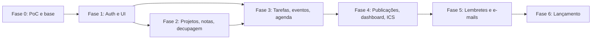

# Roadmap executável — MVP

Este roteiro deve ser seguido **na ordem das dependências**, não apenas pela facilidade de gerar CRUD com IA. As fases são entregas testáveis; não avançar se o gate de uma fase estiver quebrado. IDs apontam para [`BACKLOG.md`](BACKLOG.md).

| Fase | Entrega e valor | Tickets | Gate de saída | Esforço indicativo* |
|---|---|---|---|---|
| **0. Descoberta técnica e fundação** | Dois repositórios, SPA na Vercel, Express Workers, Neon, CI e PoCs | F0-01–F0-13 | Deploy API + web, Prisma query/tx, Queue, Cron e e-mail PoC comprovados | 10–16h |
| **1. Identidade e padrões** | Auth, autorização, shell UI, contratos e componentes | F1-01–F1-09 | Usuária entra e só vê os próprios dados | 7–12h |
| **2. Organização livre** | Projetos simples, notas e decupagem com filtros | F2-01–F2-13 | Nota/decupagem sem vínculo, vincular depois, pesquisar | 10–16h |
| **3. Planejamento operacional** | Tarefas, eventos, recorrências e agenda | F3-01–F3-17 | Regras de recorrência e exceções funcionando em agenda | 14–24h |
| **4. Conteúdo editorial** | Publicações, dashboard e exportação ICS | F4-01–F4-09 | Conteúdos na agenda, dashboard e arquivo ICS válido | 6–11h |
| **5. Notificações** | Outbox, Cron, fila, consumer e e-mail | F5-01–F5-14 | Envio fim-a-fim e falha registrada sem retry automático | 9–16h |
| **6. Qualidade e lançamento** | E2E, segurança, backups, documentação e deploy | F6-01–F6-12 | Aceite com a usuária e operação mínima documentada | 8–14h |

*Estimativas indicativas de trabalho humano com Codex, sujeitas a ajuste após a Fase 0. **Total: 64–109h**; intervalo mais largo que a estimativa inicial porque inclui documentação operacional, autenticação, recorrência robusta e validação real do runtime. Não é compromisso de prazo.

## Marcos e dependências

## Estratégia de execução com Codex

1. Abrir **um ticket por vez**, citando ID e os documentos: `AGENTS.md`, `STYLE.md` (quando UI), `REQUIREMENTS.md`, `ARCHITECTURE.md`, `DATA_MODEL.md`, `API.md`.
2. O Codex deve entregar **a parte do ticket pertencente ao repositório atual**: backend (schema/migration, DTO, repository, service, endpoint Express, testes) ou frontend (UI, cliente HTTP, testes). Dependências entre repos exigem PRs separados.
3. Não começar migrando o schema inteiro para o modelo final sem validar decisões da Fase 0; migrations pequenas, reversíveis quando possível.
4. Revisar PR por checklist e critérios de aceite; evitar grandes PRs com várias features independentes.
5. Bloquear mudanças em stack (Express → Hono, Neon → D1, Queues → BullMQ) sem ADR e aprovação.
6. Deploy dos módulos gradualmente, mas **não habilitar envio real de e-mail** antes de validação do consumer e dos destinatários.

## Critérios para declarar MVP lançado

- Roteiros e fluxos descritos em `REQUIREMENTS.md` passaram no ambiente hospedado.
- Isolamento multiusuário testado mesmo que haja uma única usuária inicial.
- Tarefas, eventos recorrentes, notas e decupagens sem vínculo, projetos opcionais, publicações e agenda funcionais no celular.
- Resumo diário e lembretes enviam e registram falhas, sem retentativas automáticas não autorizadas.
- Exportação `.ics` validada e sem alegação de sincronização com Google Calendar.
- Procedimento de backup e recuperação documentado; segredos protegidos; custo e cotas conferidos.
- Sem vulnerabilidades críticas conhecidas, sem erros de typecheck/testes/build e com feedback da usuária registrado.

## Fila pós-MVP (não executar no roadmap principal)

`V2-01` portal de aprovação; `V2-02` upload/player/transcrição; `V2-03` sincronização Google Calendar; `V2-04` notificações push/WhatsApp; `V2-05` times e permissões; `V2-06` automação de publicação; `V2-07` PWA offline/instalável; `V2-08` dashboards avançados e métricas.
